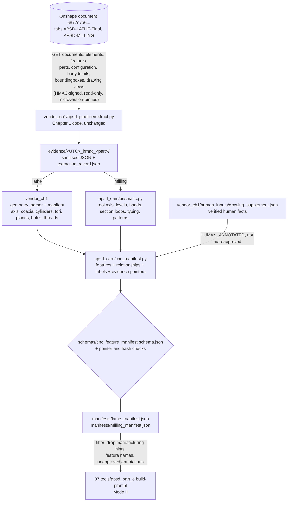

# Answers to Q2.11 – Q2.14 (Part E)

> **Evidence status on 2026-11-26.** Q2.12 is answered from the implemented, tested pipeline. Q2.11, Q2.13 and Q2.14
> need the four AI attempts, which have **not been run** (blocked by Part B inputs and the human baselines; see
> [README_Part_E.md](../README_Part_E.md#outstanding-human-tasks)). Their sections hold the measurement plan and the
> check points that were fixed **before** any AI output existed, and no results. Fill them only from archived runs and
> review records.

---

## Q2.11 – What did the drawing-based model infer correctly, incorrectly or not at all?

**Result: NOT_RUN.** Required evidence per instance: the drawing evidence (view and callout), the original AI
interpretation (quote the run's `recognized_features_raw.json` with its run id), the verified reference
(`evaluation_reference/` after G1 sign-off), the discrepancy, and the engineering consequence.

Check points fixed in advance (from the reference draft; they make "correct", "incorrect" and "not at all" decidable):

| # | Workpiece | Drawing evidence | Correct Mode I behaviour | Typical failure to look for | Consequence if wrong |
|---|---|---|---|---|---|
| 1 | Milling | Plan view shows six Ø3.5 circles; section B-B and the isometric show them **standing 4 mm above** the boss | pins (raised), height 4, radius 23 from B-B | read as Ø3.5 **holes** (drilling op) | wrong process: drilling instead of machining the boss top around the pins; stock top set too low |
| 2 | Milling | No dimension for the boss centre distance or the R115/R60 centres | flagged in `unclear_or_missing` | a numeric value is invented (scale reading) | profile and window coordinates wrong; the part does not mate with the lathe part |
| 3 | Milling | C-C "R8" ×4, plan "8" ×2 (ribs) | window corner R8 → cutter ≤ Ø16 | pocket treated as blind; wrong cutter | gouged corners / missed through-cut |
| 4 | Lathe | "Ø3,52" and "4,1" on the views, no pitch-circle dimension | holes recognised, PCD flagged as missing | PCD guessed; holes put in the turning program | off-axis holes cannot be turned on 2 axes (Q2.1) |
| 5 | Lathe | "7,98", "17,9" on the spigot end view | raised key, not 2-axis turnable | key read as a keyway/groove | wrong operation and setup |
| 6 | Lathe | Section A-A callouts "2", "20", "21", "25" without leaders to a unique surface | flagged as ambiguous | silently interpreted | thread or counterbore diameters wrong |
| 7 | Lathe | "5" pitch, "125" length; no thread designation | thread pitch and length right, designation flagged | ISO size invented | G76 depth and diameters wrong |

Report at least three of these (or other observed) instances across both parts **as observed**, including the ones the
model got right.

---

## Q2.12 – Implementation of the CAD-data pipeline

### Architecture (as implemented)



### Pseudocode (milling, `prismatic.py`)

```text
axis   := direction with the largest area of planes (normal) + cylinders/tori (axis)        -> +Z
levels := planes ⟂ axis grouped by (height, outward side)                                  -> 14+, 10+, 5+, -5-, -10-
for each band (h_i, h_i+1) between level heights:
    h := mid-height
    for each wall face (cylinder ∥ axis, plane ∋ axis):
        map its edge loops to (angle|length, height) space using edge start/quarter/mid/end points
        intervals := even-odd crossings of the line height = h   (full-circle loops bound the height)
        emit arcs/segments for those intervals
    loops := chain curves by matching end points (tol 0.01 mm)
    side  := containment depth of the loop: even = material, odd = void
type loops: full circle -> boss/pin | hole ; void with arc >= 300 deg + planar walls -> bore with slot
            other void -> through window | pocket (floor = up-facing level inside the loop)
merge identical loops of adjacent bands; find equal circles equidistant from a bore/boss centre -> pattern
```

### Input → output example (keyway end wall)

Input (`evidence/20261126T161455Z_hmac_milling/07_bodydetails.json#/bodies/0/faces/34`, metres):
```json
{"id": "JZG", "orientation": true, "area": 0.00016,
 "surface": {"type": "PLANE", "normal": {"x": 0, "y": -1, "z": 0}, "origin": {"x": 0, "y": 0.018, "z": -0.1638}}}
```
Output (`manifests/milling_manifest.json`, feature `M-KEYWAY-01`, shortened):
```json
{"id": "M-KEYWAY-01", "type": "keyway_slot", "label": "GEOMETRICALLY_INFERRED",
 "dimensions": {"width": {"value": 8.0, "unit": "mm", "evidence": ["…faces/33", "…faces/34", "…faces/32"], "note": "distance between the facing walls JZK and JZC"},
                "end_wall_distance_from_bore_axis": {"value": 18.0, "unit": "mm"},
                "depth_beyond_bore_surface": {"value": 3.0, "unit": "mm"}},
 "location": {"direction_from_bore_axis": {"value": [0.0, 1.0]}, "height_span": {"value": [-10.0, 10.0]}}}
```

### Dependencies and traceability
Python 3.13; `requests`, `python-dotenv`, `jsonschema`, `pytest` (pinned). Onshape API v17 with read-only keys from
`.env` (git-ignored); no paid service. Every value carries a provenance label and evidence pointers. The tests resolve
every pointer, check the SHA-256 of every evidence file, and check that the committed manifests are reproduced exactly
from the committed evidence.

### Reliably extracted vs human annotation
- **Reliable (exact analytic B-rep):** all diameters and radii, arc centres and sweeps, plane heights, bounding box,
  feature positions, the lathe profile with axial spans, R5 and R2 fillets, holes and bores, the keyway geometry, the
  through window, pin positions, height and PCD, and the boss centre distance (105 mm, **not on the drawing**).
- **Needs a human annotation or stays UNKNOWN:** thread designations and sizes (the CAD thread feature reports
  `majorDiameter = 25` on Ø50 and Ø12 regions, which is inconsistent), material, stock, tolerances and fits, surface
  finish, chamfers and edge breaks, and drawing callouts in general (the drawing API returns no dimension text). The
  verified drawing fact `H-L-01` (external thread present, pitch 5, length 125) exists but is **not sent** in Mode II
  unless the team approves it, because it comes from the drawing.
- **Model inconsistency found:** the lathe Hole feature says Ø14, the evaluated bore is Ø12. Flagged as
  `needs_human_verification`.

### Technical limitations
Works for world-aligned tool axes only (true here). Feature typing is inferred from geometry, not from manufacturing
semantics. Thread regions come from loose boxes of helical faces. Sections are taken at band mid-heights (blends are
reported separately). The `orientation` field is undocumented (observed convention, checked on both parts). The pipeline
needs API access to re-extract; the committed evidence makes everything else reproducible offline.

---

## Q2.13 – Comparison of both AI modes with the manual baseline

**Result: NOT_MEASURED** (no AI attempt, no baseline committed). Definitions and measurement methods:
[evaluation_methodology.md](evaluation_methodology.md). The table is produced by `python -m apsd_part_e matrix`. The
current output ([six_case_matrix.csv](six_case_matrix.csv)) contains only `MISSING_DEPENDENCY` and `NOT_RUN`.

| Measure | Lathe manual | Lathe I | Lathe II | Milling manual | Milling I | Milling II |
|---|---|---|---|---|---|---|
| Recognized-feature coverage | – | NOT_RUN | NOT_RUN | – | NOT_RUN | NOT_RUN |
| Dimensional discrepancies (mm) | – | NOT_RUN | NOT_RUN | – | NOT_RUN | NOT_RUN |
| Program issues (crit/major/minor) | MISSING_DEPENDENCY | NOT_RUN | NOT_RUN | MISSING_DEPENDENCY | NOT_RUN | NOT_RUN |
| Simulator-validated operations | PENDING_SIMULATION | NOT_RUN | NOT_RUN | PENDING_SIMULATION | NOT_RUN | NOT_RUN |
| Human interventions | n/a | NOT_RUN | NOT_RUN | n/a | NOT_RUN | NOT_RUN |
| Development effort (min) | NOT_MEASURED | NOT_RUN | NOT_RUN | NOT_MEASURED | NOT_RUN | NOT_RUN |

Do not write a conclusion such as "Mode II is better" unless these numbers support it. Note the asymmetry for the
discussion: Mode II receives undimensioned values (e.g. the 105 mm centre distance), so it can be "correct" where the
best possible Mode I answer is "flagged as missing". The coverage definition handles this explicitly.

---

## Q2.14 – Failure-and-correction sequences

**Result: NOT_RUN.** Use one **real** failure per process, taken from the review records. Templates:
[turning_error_analysis.md](turning_error_analysis.md), [milling_error_analysis.md](milling_error_analysis.md).
